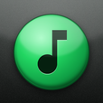
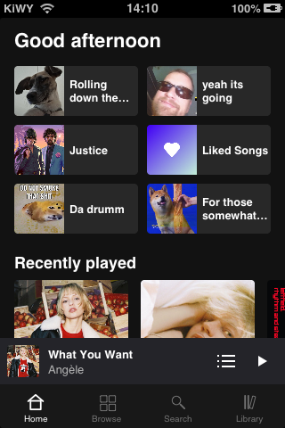
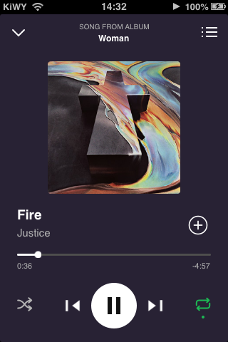
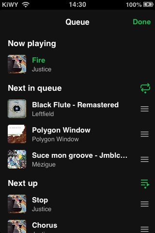
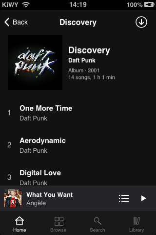
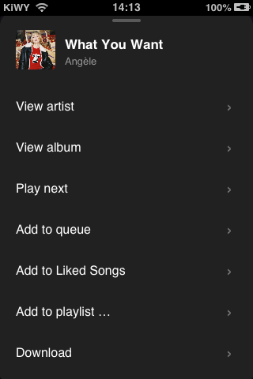
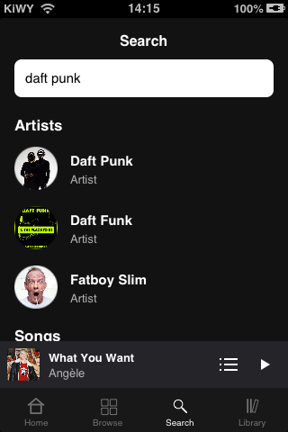
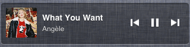

<p align="center"></p>

<h1 align="center">Spotify6</h1>

<p align="center"><b>Spotify, back on iOS 6.</b><br>A native Spotify client for jailbroken iOS 6.</p>

---

Spotify6 puts your whole Spotify account on iOS 6: your playlists, your queue and your offline music. It runs entirely on the phone and works with your existing account.

Spotify6 is based on [riff](https://github.com/SecondTrack/riff) by Second Track, which provides the Spotify connection and audio playback underneath. Big thanks to them for making it open source.

<table align="center">
  <tr>
    <td align="center" valign="top"><b>Home</b><br></td>
    <td align="center" valign="top"><b>Now playing</b><br></td>
    <td align="center" valign="top"><b>Queue</b><br></td>
    <td align="center" valign="top"><b>Album</b><br></td>
  </tr>
  <tr>
    <td align="center" valign="top"><b>Song menu</b><br></td>
    <td align="center" valign="top"><b>Recent searches</b><br></td>
    <td align="center" valign="top"><b>Search</b><br></td>
    <td align="center" valign="top"><b>Notification Center</b><br></td>
  </tr>
</table>

> [!IMPORTANT]
> Spotify6 is an unofficial project and is **not affiliated with Spotify**. It talks to Spotify through undocumented interfaces using your own account, which may be against Spotify's Terms of Use and could stop working at any time. **Spotify Premium is required.** Use it at your own risk.

## Features

- **Queue** with *Next in queue* and *Next up*: drag to reorder, swipe to add or remove, repeat the queue, or stop when it runs out
- **Song menu**: long-press any song to view the artist or album, queue it, like it, add it to a playlist or download it
- **Home** with the playlists, albums and artists you played recently, plus recently played songs, including plays from the phone
- **Search** for artists, songs and albums, with your recent searches
- **Artist and album pages**, with an optional big-cover look for albums and playlists
- **Offline** playlists, albums and single songs, with resumable and background downloads
- **Notification Center widget** with cover, title, "Playing from …" and playback controls
- **Mini player** you can swipe to skip, and a full player you drag down to close
- **Official covers** for Spotify-made playlists such as Blends and Your Top Songs
- **Cover Flow** when you turn the phone sideways
- **Gapless playback**: the next song is ready before the current one ends
- **Sign in with a code** at spotify.com/pair, no password needed

## Requirements

| | |
|---|---|
| Device | An armv7 device on **iOS 6**, jailbroken. So far only tested on an iPhone 3GS. |
| Installer | **AppSync** (Spotify6 installs as a normal app) |
| Account | **Spotify Premium** |
| Search | Your own free Spotify developer key (the app shows you how to create one in about three minutes) |
| Widget | **WeeLoader** by chpwn, from Cydia |

## Signing in

Spotify6 never asks for your password. On first launch it shows a short code. Enter it at **spotify.com/pair** on any other device and you are in. The login is stored only on the phone, inside the app's own folder, and renews itself.

## Building

Needs [Theos](https://theos.dev) with the **iPhoneOS 9.3 SDK**. The app targets iOS 6.0 and builds with `-Werror`.

```sh
# TLS library: downloads the official Mbed TLS 3.6.7 release, checks its SHA-256, builds it for armv7
vendor/mbedtls/fetch.sh
vendor/mbedtls/build.sh

# Build the release IPA and install it over USB (ideviceinstaller + AppSync)
scripts/install.sh
```

A plain `gmake package` builds a debug version with an extra test hook (`music/App/MMDebug.m`) for driving the app over SSH; release builds leave it out.

**Notification Center widget** (optional, `widget/`): build it with `gmake package FINALPACKAGE=1` inside `widget/`, install the `.deb` on the device with `dpkg -i`, respring, and turn it on in iOS Settings → Notifications. It can be switched off any time in Spotify6's settings.

## How it works

Spotify6 signs in to a Spotify access point the way Spotify's own clients do and keeps that connection open for metadata and the keys that unlock each song. Your library comes from the same internal servers the official apps use; only search goes through the public Web API, with your own developer key.

Songs are fetched from Spotify's CDN in their encrypted form, decrypted on the phone and decoded from Ogg Vorbis in software. Spotify6 uses the 160 kbps version, which keeps decoding at roughly 7–9 % of the 3GS's CPU. Because iOS 6 can no longer talk to some of Spotify's servers securely, all HTTPS traffic runs through a bundled Mbed TLS with full certificate checks.

The widget is a small plugin inside SpringBoard that reads what's currently playing from the system and sends the same commands as the lock screen.

## Credits

Spotify6 began as a fork of **[riff](https://github.com/SecondTrack/riff) by Second Track**, which made Spotify playback on iOS 6 possible in the first place: the protocol work, the audio pipeline and the first version of the app. Thank you!

Also used:
- [stb_vorbis](https://github.com/nothings/stb) by Sean Barrett: Ogg Vorbis decoding (public domain / MIT)
- [Mbed TLS](https://github.com/Mbed-TLS/mbedtls): TLS (Apache 2.0)
- The Shannon cipher, ported from rust-shannon in [librespot](https://github.com/librespot-org/librespot) (MIT)
- [Material Icons](https://github.com/google/material-design-icons) "music_note" in the app icon (Apache 2.0)

Details are in [NOTICE](NOTICE).

## License

GNU General Public License v3.0, see [LICENSE](LICENSE).

Spotify is a trademark of Spotify AB. iPhone and iOS are trademarks of Apple Inc. Spotify6 is not affiliated with or endorsed by Spotify or Apple.
